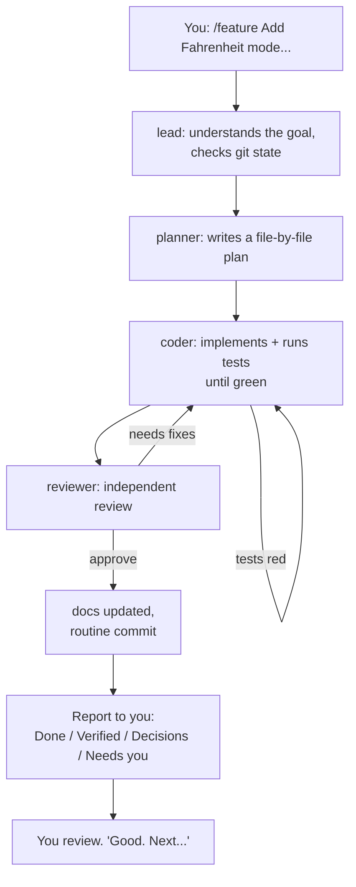
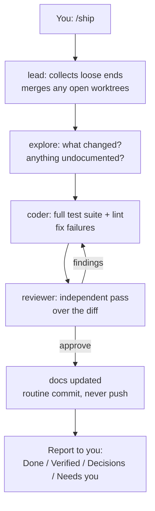
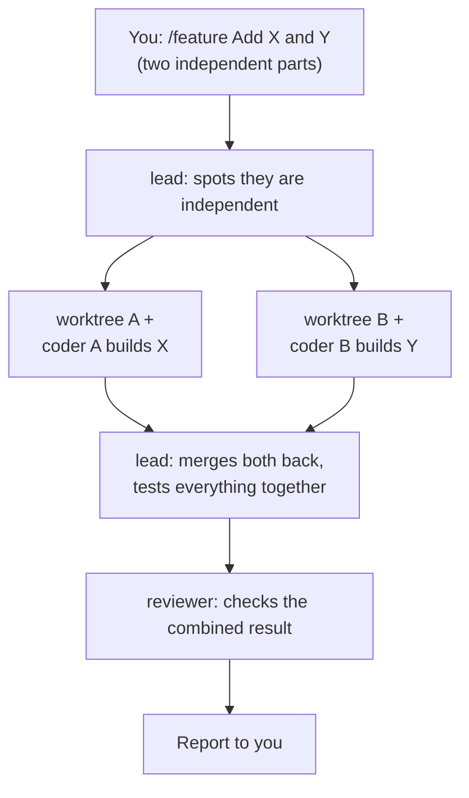
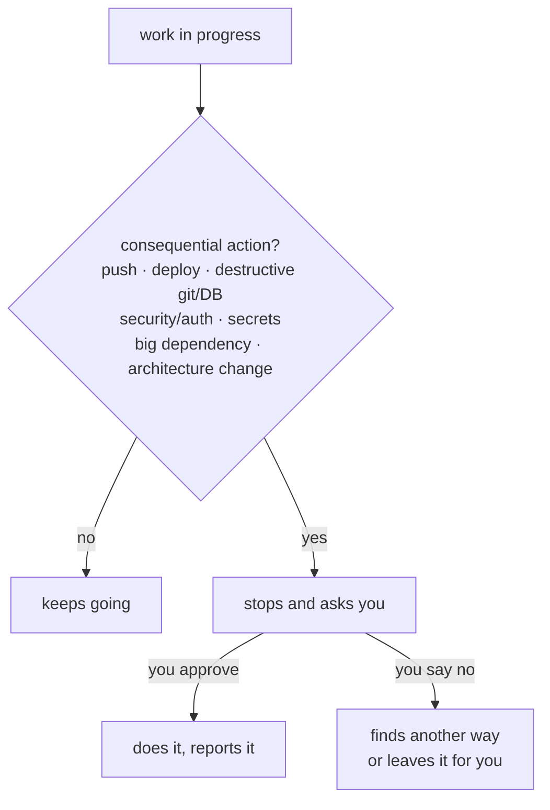

# OpenCode Engineering Harness

> You say **what + why**. The harness handles **how**.

This repo turns [opencode](https://opencode.ai) into a small engineering team.
You describe a feature in plain language; a lead agent plans it, specialists
build / test / review it, and you get a short report. You stay the product
owner — the harness stays the engineering department.

This repo is the **staging ground** where the harness is built and tested
before it is copied into real projects as a template.

## Quick start

1. Install opencode, clone this repo, and **restart opencode** (it loads config
   once at startup — restart after any change to `opencode.json`, agents, or
   commands).
2. Check the environment: `python3 -m unittest discover -s sandbox`
3. Try it: `/feature Add a --version flag to the sandbox CLI, with tests.`
4. Close out: `/ship` — then read the report.
5. Anything pushes, deploys, or destructive? The harness stops and asks you first.

## What you type

There are only three commands, and all of them talk to the lead agent:

| You type | What happens | When to use it |
|---|---|---|
| `/feature <describe what you want>` | Full loop: understand → plan → build → test → review → document → commit. | Any new feature or change. |
| `/ship` | Closes out current work: merges loose ends, runs all tests, gets a review, commits. Never pushes. | When work feels done and you want it wrapped up. |
| `/status` | Tells you: current branch, uncommitted changes, recent commits, open worktrees. Changes nothing. | When you want to know where things stand. |

Every finished task ends with the same short report:

- **Done** — what changed (1–3 lines)
- **Verified** — tests/lint results
- **Decisions** — anything redesigned or deviated
- **Needs you** — anything needing your judgment

## Workflow: building a feature

This is the main path. You write one sentence; the team does the rest.



What to notice:

- You never assign tasks to specialists — `lead` does that.
- Tests must be green before anything is called done.
- A second pair of eyes (`reviewer`) checks everything.
- Commits happen automatically. **Push never happens without your approval.**

## Workflow: closing out with /ship

`/ship` is the "wrap it up" button. Use it after a feature — or anytime the
workspace feels messy.



## Workflow: two independent things at once

If you ask for two things that don't depend on each other, the harness works
on both in parallel — each in its own isolated copy (a *worktree*), then
merges both back.



You don't manage the worktrees — `lead` creates them, merges them, and cleans
up. `/status` shows them while they're alive.

## Workflow: when you get asked to step in

The harness works autonomously **except** at the approval boundary. Then it
stops and waits for you.



The full boundary list lives in [.opencode/constitution.md](file:///home/nick/Documents/Projects/opencode-workflow/.opencode/constitution.md).
The short version: it will never push, deploy, delete significant code, touch
secrets, or redesign your architecture without asking.

## The team (one line each)

- **lead** — the orchestrator you talk to. Coordinates, never implements
  features itself (only trivial merge/one-line fixes).
- **planner** — writes the implementation plan. Read-only.
- **coder** — builds it, runs tests until green.
- **reviewer** — independent check with fresh eyes. Read-only, runs tests.
- **researcher** — looks up docs, APIs, versions. Read-only.
- **explore** (built-in) — fast codebase lookup.

Specialists never delegate to each other — `lead` is the only coordinator.

## What's in this repo

```
.
├── README.md                  # This file (human overview)
├── AGENTS.md                  # Workspace notes (project facts, conventions)
├── opencode.json              # Config: team, permissions, safety gates
├── .opencode/
│   ├── CHARTER.md             # What this project IS and IS NOT
│   ├── ROADMAP.md             # The only list of approved features
│   ├── DECISIONS.md           # Past decisions — don't relitigate
│   ├── constitution.md        # Rules every agent follows
│   ├── agents/                # lead, planner, coder, reviewer, researcher
│   └── commands/              # feature, ship, status
├── sandbox/                   # Tiny practice project the harness is tested on
├── docs/validation.md         # Test checklist + sign-off (scenarios 1–12)
└── plugin/opencode-worktree/  # Worktree plugin (parallel isolation)
```

## Where to look next

- New to the project? Read [.opencode/CHARTER.md](file:///home/nick/Documents/Projects/opencode-workflow/.opencode/CHARTER.md) first (5 minutes).
- Want to know what's planned? [.opencode/ROADMAP.md](file:///home/nick/Documents/Projects/opencode-workflow/.opencode/ROADMAP.md) is the only approved list.
- Wondering "why is it like this?" Check [.opencode/DECISIONS.md](file:///home/nick/Documents/Projects/opencode-workflow/.opencode/DECISIONS.md) before reopening a debate.
- Proof it works: [docs/validation.md](file:///home/nick/Documents/Projects/opencode-workflow/docs/validation.md) (scenarios 1–11 pass; 12 pending a restart check).
- opencode itself: [agents](https://opencode.ai/docs/agents/), [commands](https://opencode.ai/docs/commands/), [permissions](https://opencode.ai/docs/permissions/).
